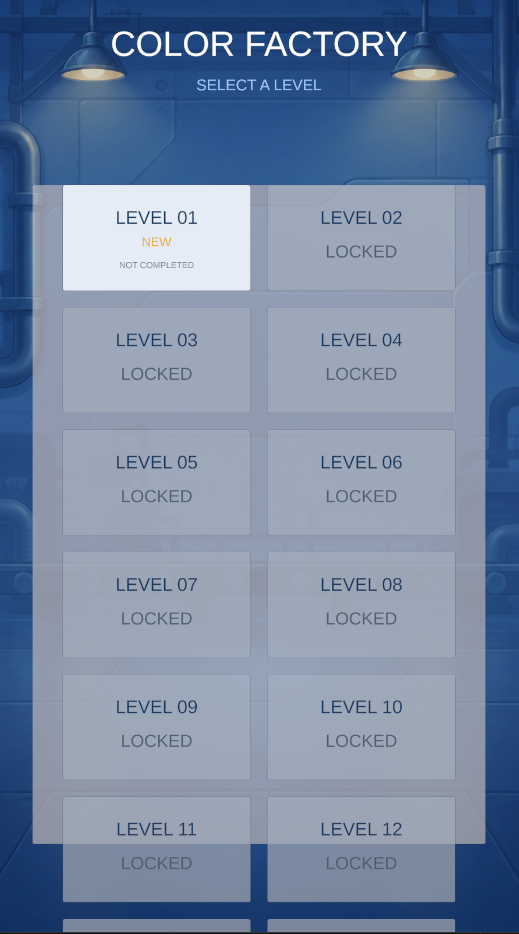
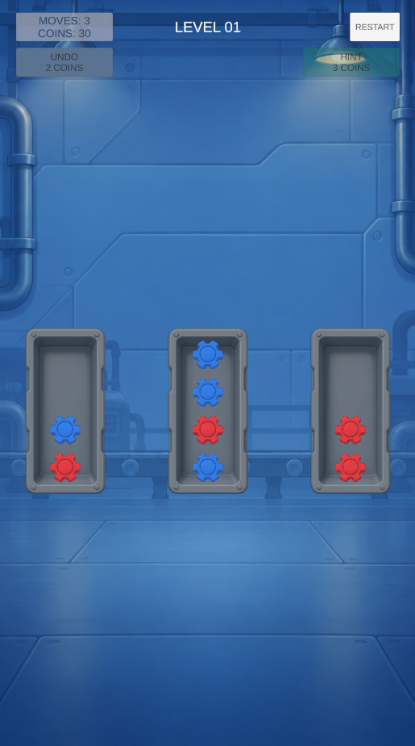
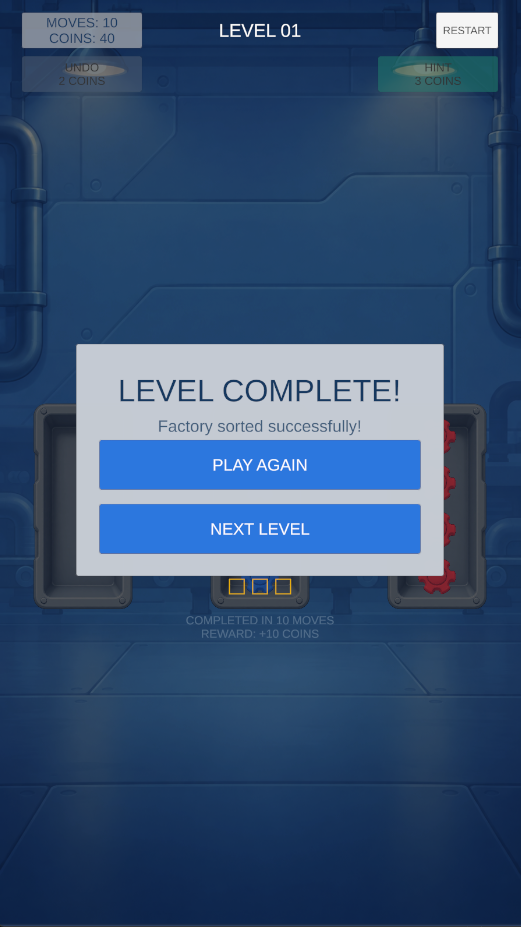

# Color Factory

Mobile toy-sorting puzzle cho Android (portrait 9:16). Người chơi chọn khay nguồn rồi khay đích; mỗi khay cuối cùng chỉ chứa một màu.

Phần của dự án portfolio `PuzzlePortfolio`. Unity 6000.3.25f1, Universal 2D (URP), C#.

## Mở project

1. Mở Unity Hub, chọn Unity **6000.3.25f1** (hoặc tương đương) và mở thư mục `ColorFactory`.
2. Chờ import xong và compile không lỗi.
3. Mở `Assets/_Project/Scenes/LevelSelect.unity` và nhấn Play.

## Cấu trúc

| Thư mục | Nội dung |
|---|---|
| `Assets/_Project/Scripts/` | Code runtime (asmdef `ColorFactory.Runtime`): gameplay thuần C# (`BoardModel`), view, service, level |
| `Assets/_Project/Editor/` | Công cụ Editor: kiểm tra catalog level, build APK |
| `Assets/_Project/Tests/` | Test Edit Mode và Play Mode |
| `Assets/_Project/Data/` | `LevelData` (15 level), catalog, cấu hình audio |
| `Assets/_Project/Scenes/` | `LevelSelect`, `GamePlay`, `SceneBenchmark` (chỉ dùng để đo, không có trong build) |
| `docs/` | Kế hoạch bài học, tài liệu setup từng bài, evidence đo đạc |
| `docs/tools/` | Bộ giải BFS kiểm tra số nước tối thiểu của level |

## Kiến trúc tóm tắt

- Gameplay rule nằm trong `BoardModel` (C# thuần). View chỉ render và nhận input.
- Mọi asset runtime tải bằng Addressables key. `LevelData` chỉ lưu key, không lưu tham chiếu prefab.
- `AddressableService` và `SceneAssetScope` là nơi duy nhất giải phóng handle Addressables.
- `PoolService` giữ instance active và inactive; khi rời scene thì hủy instance trước khi release asset.
- Thông báo giữa các view dùng callback/Signal, không phụ thuộc chéo qua serialized field.

## Build

| Việc | Cách làm |
|---|---|
| APK Development | `Color Factory > Build > Android APK (Development)` |
| APK Release candidate | `Color Factory > Build > Android APK (Release)` |
| Output | `Builds/Android/ColorFactory-<version>-<dev\|release>.apk` (không commit) |
| Keystore | Không commit. Xem `docs/LESSON_30_SETUP.md` mục Keystore policy |

Commands
```powershell
D:\Anhtdt_Programs\Unity\Editor\6000.3.25f1\Editor\Unity.exe" -batchmode -nographics -quit -projectPath "D:\Repositories\PuzzlePortfolio\ColorFactory" -buildTarget Android -executeMethod ColorFactory.EditorTools.AndroidReleaseBuild.BuildReleaseApk -logFile "D:\Repositories\PuzzlePortfolio\ColorFactory\build_release.log"
```


Chi tiết và checklist cài đặt trên thiết bị: `docs/LESSON_30_SETUP.md`.

## Kiểm thử

| Bộ | Lệnh / cách chạy | Kết quả đã ghi nhận |
|---|---|---|
| Edit Mode | Test Runner > EditMode > Run All | 43/43 passed (`docs/profiling/test_editmode_results.xml`) |
| Play Mode | Test Runner > PlayMode > Run All | 5/5 passed (`docs/profiling/test_playmode_results.xml`) |
| Level catalog | `Color Factory > Validate Level Catalog` | Xem `docs/LESSON_27_SETUP.md` |

## Trạng thái bài học

| Bài | Nội dung | Trạng thái |
|---|---|---|
| 20–25 | Scene fade, polish, atlas, audio, economy, analytics | Đã code; một số chờ kiểm thử trong Editor |
| 26 | Hint solver Jobs/Burst benchmark | Đã code, **chưa có số đo** (`benchmark.csv` chưa có) |
| 27 | Level 04–15 và cân bằng | Đã có dữ liệu và validator |
| 28 | Test suite | Đã chạy, pass |
| 29 | Profiling và Addressables evidence | Khung tài liệu, **chờ số đo thật** trên Android |
| 30 | Android release candidate | Đã có build script và tài liệu; chờ kiểm tra trên thiết bị |

## Vấn đề đã biết

- Level_001: 3 sao (8 nước) thấp hơn nước tối thiểu (10). Không đạt được 3 sao ở level này.
- Build APK Android thử (batch) thất bại do package `com.unity.ai.assistant` (voice mẫu `Liam.wav` không nén được cho Android). Cần quyết định gỡ package hoặc loại voice mẫu; xem `docs/LESSON_30_SETUP.md`.
- Evidence profiling (screenshot Profiler, Memory Profiler, Event Viewer, benchmark) cần chạy trên Android thật.

## Game screenshots:





